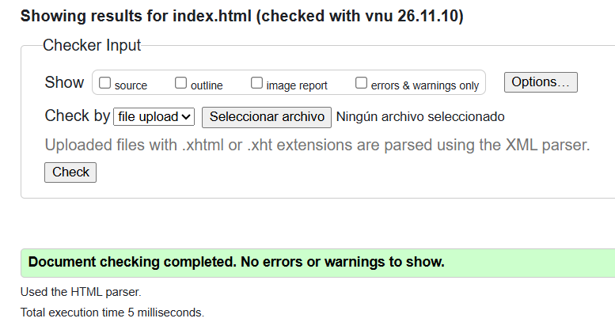
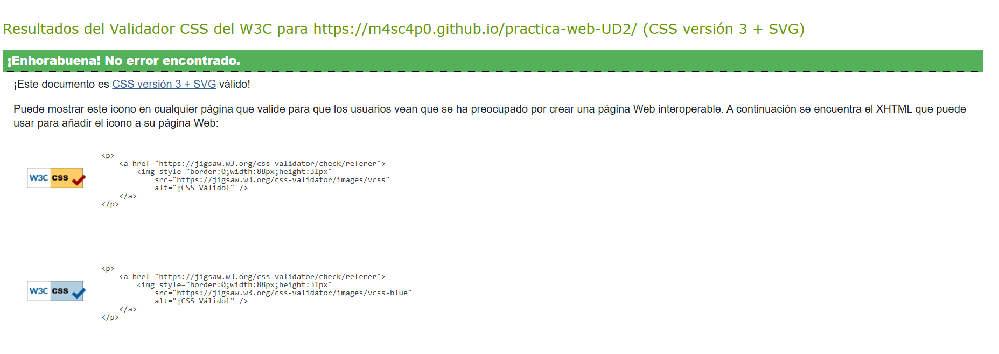
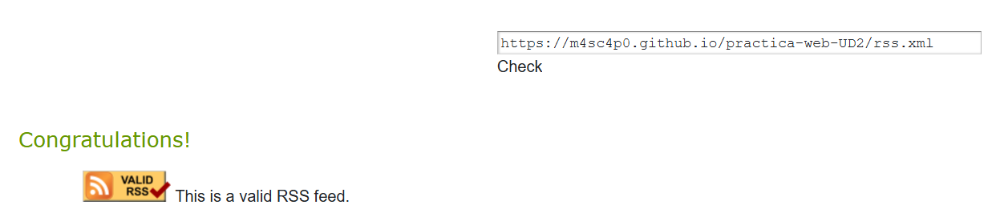

# practica-web-UD2
Breve descripción del sitio web y de su temática.
## Autoría
- Nombre y apellidos: Jerónimo Mejía Benavides
- Curso: 1 DAM A
- Fecha: 11/11/2026
## Sitio publicado
- Web en GitHub Pages: [Abrir sitio](https://m4sc4p0.github.io/practica-web-UD2/index.html)
- Repositorio: [Abrir repositorio](https://github.com/m4sc4p0/practica-web-UD2)
## Estructura del proyecto
- `index.html`: página principal que presenta Esperpéntico, explica la temática del sitio y permite acceder a las distintas secciones.
- `blog.html`: artículo sobre la evolución del cine español, desde sus comienzos hasta la actualidad.
- `tabla.html`: catálogo de películas españolas organizado por géneros, con información sobre títulos, directores, años de estreno y duración.
- `galeria.html`: página destinada a mostrar carteles, fotografías y recursos audiovisuales relacionados con el cine español.
- `formulario.html`: formulario de participación para que los visitantes compartan sus preferencias cinematográficas y recomienden películas.
- `rss.xml`: archivo XML que contiene el canal RSS del sitio y permite consultar las novedades y contenidos publicados.
- `css/estilos.css`: hoja de estilos externa compartida por las páginas HTML.
- `img/`: carpeta que contiene el logotipo y las imágenes utilizadas en el sitio web.
- `audios/`: carpeta que contiene los audios utilizadas en el sitio web.
- `videos/`: carpeta que contiene los vídeos utilizadas en el sitio web.
- `subtitulos/`: carpeta que contiene los subtítulos utilizadas en el sitio web.
## Tecnologías utilizadas
- HTML5
- CSS
- XML y RSS
- Git
- GitHub
- GitHub Pages
## Características principales
- Navegación entre cinco páginas.
- Uso de HTML semántico.
- Tabla accesible.
- Galería con varios formatos.
- Contenido multimedia.
- Formulario con validación HTML.
- Canal RSS.
## Validación
### HTML

### CSS

### RSS

## Dificultades encontradas
Describe al menos tres dificultades reales:
1. Problemas al insertar vídeos de YouTube. Al principio, el reproductor mostraba un error de conexión porque se estaba utilizando una dirección normal de YouTube. Se solucionó utilizando el formato de inserción mediante youtube-nocookie.com/embed/ y comprobando que el vídeo permitiera la reproducción externa (copiando el código desde el vídeo en YouTube).
2. Organización de los recursos multimedia locales. Fue necesario distinguir entre las imágenes de portada, los vídeos y los audios, y organizar cada recurso en su carpeta correspondiente. También se tuvo que prestar atención a las rutas de los archivos y a sus formatos reales para evitar errores de reproducción.
3. Configuración del canal RSS. Surgieron dudas sobre la estructura del documento XML, la información que debía incluir cada elemento item y la diferencia entre declarar el RSS en la cabecera HTML y ofrecer un enlace visible en la página. Se resolvió organizando los contenidos dentro de channel y añadiendo un enlace al archivo rss.xml.
## Decisiones técnicas
Explica brevemente:
- Organización de archivos: se han separado los documentos HTML, la hoja de estilos y los recursos gráficos en diferentes carpetas para facilitar su mantenimiento.
- Partes comunes: todas las páginas comparten una estructura general con cabecera, pie de página, logotipo, título y menú de navegación.
- Contenido específico: cada página desarrolla una función diferente: presentación, artículo, catálogo de películas, galería o formulario.
- Formatos de imagen: se utilizan JPG para fotografías e imágenes, PNG cuando se necesita transparencia, WebP para optimizar el tamaño de las imágenes y SVG para logotipos e iconos vectoriales.
- Rutas relativas: se utilizan rutas como css/estilos.css e img/Logo.png para enlazar los recursos desde las páginas HTML. Esto permite mantener el proyecto organizado y facilita su publicación.
- Preparación para CSS: se ha vinculado una hoja de estilos externa común, de modo que el diseño visual pueda modificarse desde un único archivo sin tener que cambiar la estructura HTML de cada página.
## Fuentes y licencias
Vídeo de un proyector de cine antiguo. Licencia: Pixabay Content License.
Elegant Cinematic Beat – Tunetank. Licencia: Pixabay Content License.
Recurso: Small Film Projector. Licencia: Pixabay Content License.
